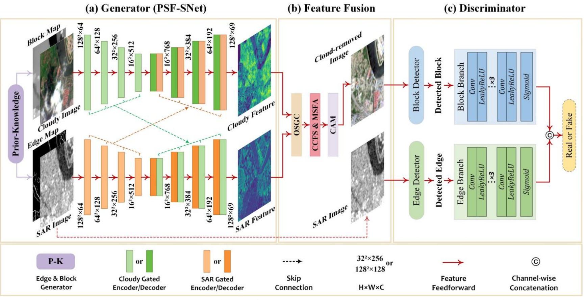
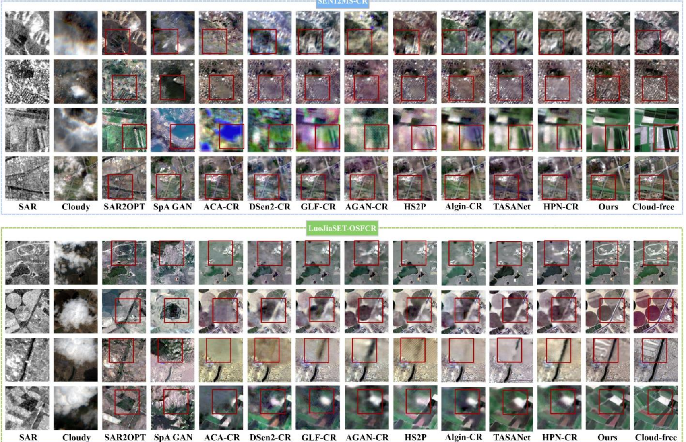
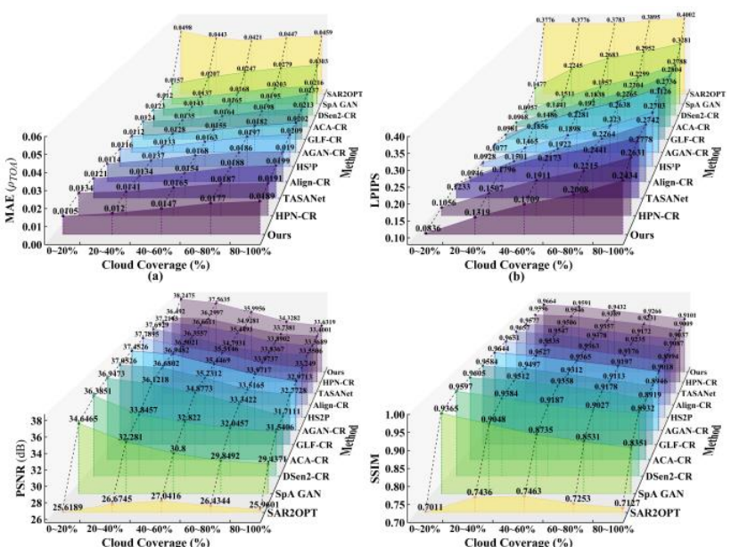
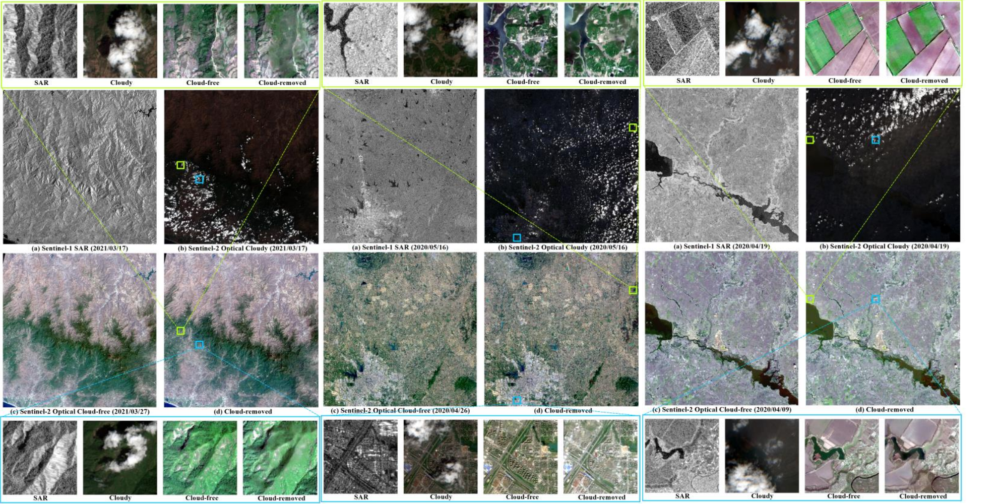

<div align="center">

# PDF-OS-CR

### Prior-Driven Cross-Coupling Incremental Fusion Network for Cloud Removal with Optical-SAR Data

**Lingze Zeng · Xinghua Li · Huanfeng Shen**  
Wuhan University

[Paper](https://ieeexplore.ieee.org/document/11733863) · [DOI](https://doi.org/10.1109/TCSVT.2026.3742474) · [Overview](#overview) · [Architecture](#architecture) · [Results](#results) · [Installation](#installation) · [Datasets](#dataset-preparation) · [Training](#training) · [Evaluation](#evaluation)

</div>

> **Paper:** Published online in *IEEE Transactions on Circuits and Systems for Video Technology* (Early Access), 12 October 2026. [IEEE Xplore](https://ieeexplore.ieee.org/document/11733863) · [DOI](https://doi.org/10.1109/TCSVT.2026.3742474)

## Overview

Thick clouds completely hide optical observations and create spatial and temporal gaps in remote-sensing imagery. Synthetic aperture radar (SAR) can observe the same surface through clouds, but its imaging mechanism and speckle noise make direct optical-SAR fusion difficult.

**PDF-OS-CR** is a generative adversarial network for reconstructing cloud-free optical RGB images from:

- a cloud-covered optical image;
- a dual-polarization Sentinel-1 SAR image (VV and VH);
- an SAR edge prior produced with Canny; and
- an SAR block/structure prior produced with relative total variation (RTV) smoothing.

The method first performs prior-guided shared fusion in **PSF-SNet**, then progressively reconstructs missing information through optical-SAR global coupling, cloud-context similarity, multi-scale aggregation, and a learned cloud attention map. A dual-branch discriminator supervises both regional appearance and edge structure.

## Architecture

<p align="center">
  
</p>

The network contains three main parts:

1. **Generator / PSF-SNet.** The optical stream receives the cloudy RGB image together with the two-channel SAR block prior. The SAR stream receives VV/VH together with the two-channel edge prior. Shared gated encoder-decoder features and skip connections progressively align the modalities.
2. **Feature-fusion stage.** OSGC performs optical-SAR cross-learning, CCFS matches cloud-covered and cloud-free context, MSFA aggregates multiple spatial scales, and CAM blends the reconstructed content with reliable optical observations.
3. **Dual-branch discriminator.** The block branch evaluates regional realism, while the edge branch evaluates structural consistency using detected and SAR-guided edges.

## Results

All values below are **reported in the paper**. They were not recomputed during repository cleanup. Higher PSNR/SSIM and lower MAE/LPIPS are better.

### SEN12MS-CR

| Method | SAR | Optical | MAE ↓ | LPIPS ↓ | PSNR (dB) ↑ | SSIM ↑ |
|---|:---:|:---:|---:|---:|---:|---:|
| SAR2OPT | ✓ | — | 0.0456 | 0.3890 | 26.2255 | 0.7214 |
| SpA GAN | — | ✓ | 0.0256 | 0.2733 | 30.8540 | 0.8678 |
| ACA-CR | — | ✓ | 0.0191 | 0.2113 | 33.7841 | 0.9204 |
| DSen2-CR | ✓ | ✓ | 0.0183 | 0.2146 | 33.2508 | 0.9142 |
| GLF-CR | ✓ | ✓ | 0.0181 | 0.2116 | 34.3758 | 0.9191 |
| AGAN-CR | ✓ | ✓ | 0.0170 | 0.2449 | 34.6628 | 0.9256 |
| HS2P | ✓ | ✓ | 0.0177 | 0.2081 | 34.7905 | 0.9245 |
| Align-CR | ✓ | ✓ | 0.0168 | 0.2114 | 34.7525 | 0.9297 |
| TASANet | ✓ | ✓ | 0.0171 | 0.2275 | 34.7402 | 0.9246 |
| HPN-CR | ✓ | ✓ | 0.0169 | 0.2077 | 34.6983 | 0.9297 |
| **PDF-OS-CR** | ✓ | ✓ | **0.0160** | **0.1874** | **35.2691** | **0.9322** |

### LuojiaSET-OSFCR

The released model uses three optical bands for both training and evaluation.

| Method | Train bands | Test bands | MAE ↓ | LPIPS ↓ | PSNR (dB) ↑ | SSIM ↑ |
|---|---:|---:|---:|---:|---:|---:|
| SAR2OPT | — | — | 0.0554 | 0.3992 | 25.5109 | 0.7909 |
| SpA GAN | 3 | 3 | 0.0279 | 0.3301 | 30.3174 | 0.8660 |
| ACA-CR | 3 | 3 | 0.0130 | 0.2496 | 36.7039 | 0.9387 |
| DSen2-CR | 13 | 3 | 0.0138 | 0.3012 | 35.8778 | 0.9227 |
| GLF-CR | 13 | 3 | 0.0121 | 0.2809 | 36.6494 | 0.9312 |
| AGAN-CR | 3 | 3 | 0.0118 | 0.2963 | 36.8683 | 0.9339 |
| HS2P | 13 | 3 | 0.0110 | 0.2554 | 37.5865 | 0.9323 |
| Align-CR | 3 | 3 | 0.0118 | 0.2713 | 37.3404 | 0.9356 |
| TASANet | 13 | 3 | 0.0123 | 0.2581 | 37.0876 | 0.9396 |
| HPN-CR | 13 | 3 | 0.0125 | 0.2758 | 36.6735 | 0.9345 |
| **PDF-OS-CR** | **3** | **3** | **0.0099** | **0.2142** | **38.7638** | **0.9455** |

### Model complexity

| Parameters | FLOPs | Average inference time |
|---:|---:|---:|
| 18.93 M | 56.38 G | 61.69 ms |

### Qualitative comparison

<p align="center">
  
</p>

The top four rows are SEN12MS-CR scenes and the bottom four rows are LuojiaSET-OSFCR scenes. The comparisons cover mountains, cities, farmland, water, and different cloud densities.

### Robustness to cloud coverage

<p align="center">
  
</p>

PDF-OS-CR remains competitive across five cloud-coverage intervals from 0–20% to 80–100%, including heavily occluded scenes.

### Large-scale scenes

<p align="center">
  
</p>

From left to right: mountainous, urban, and farmland scenes. Large scenes were reconstructed patch by patch with 50% overlap, as described in the paper.

## Installation

The experiments in the paper used **PyTorch 1.9.1** and an NVIDIA Quadro RTX 5000. Create an isolated Python environment, install a PyTorch build compatible with your CUDA toolkit, and install the remaining dependencies:

```bash
git clone https://github.com/lixinghua5540/PDF-OS-CR.git
cd PDF-OS-CR
pip install -r requirements.txt
```

The main dependencies are PyTorch, Rasterio, NumPy, SciPy, OpenCV, scikit-image, timm, pytorch-msssim, LPIPS, TensorBoardX, Matplotlib, THOP, and pypardiso.

## Dataset Preparation

This repository contains the CSV split manifests, but not the source satellite imagery. Download or prepare the datasets separately, then set their paths in `TRAIN_PATHS` and `TEST_PATHS` before running the scripts.

### Split identifiers

The first CSV column defines the split:

| Value | Split |
|:---:|---|
| `1` | Training |
| `2` | Validation |
| `3` | Testing |

The included manifests contain:

| Dataset | Train | Validation | Test | Total |
|---|---:|---:|---:|---:|
| SEN12MS-CR | 107,143 | 7,176 | 7,899 | 122,218 |
| LuojiaSET-OSFCR | 16,000 | 1,000 | 3,000 | 20,000 |

### SEN12MS-CR

Each row in `data/data_SEN12MS.csv` has the following layout:

```text
split,sar_dir,cloudy_dir,cloud_free_dir,edge_dir,block_dir,file_name
```

Expected directory structure:

```text
SEN12MS-CR/
├── ROIs1158_spring_s1/
├── ROIs1158_spring_s2_cloudy/
├── ROIs1158_spring_s2/
├── ROIs1158_spring_s1_edge/
└── ROIs1158_spring_s1_structure/
```

Directory names vary by ROI and season and are read directly from the CSV manifest.

### LuojiaSET-OSFCR

Each row in `data/data_LuoJia.csv` has this layout:

```text
split,cloud_range,sar_dir,cloudy_dir,cloud_free_dir,edge_dir,block_dir,file_name
```

Expected directory structure:

```text
LuojiaSET-OSFCR/
├── 0-20%/
│   ├── s1/
│   ├── s2_cloudy/
│   ├── s2/
│   ├── sar_edge/
│   └── sar_structure/
├── 20-40%/
├── 40-60%/
├── 60-80%/
└── 80-100%/
```

### Input conventions

- SAR input: Sentinel-1 VV and VH, clipped to `[-25, 0]` and `[-32.5, 0]`, then normalized to `[0, 1]`.
- Optical input: three optical bands selected by the released loader and divided by 10,000.
- Spatial size: 256 × 256 pixels in the released experiments.
- Priors: two-channel SAR edge and block GeoTIFFs aligned with the source images.

## Pretrained Models

Two pretrained checkpoints are included:

| Dataset | Checkpoint |
|---|---|
| SEN12MS-CR | `ckpt/SEN12MS-CR/best_model.pt` |
| LuojiaSET-OSFCR | `ckpt/LuojiaSET-OSFCR/best_model.pt` |

Each checkpoint stores the epoch, generator state dict, and discriminator state dict. Evaluation uses the checkpoint configured for the selected dataset in `TEST_PATHS`.

## Training

Run all commands from the repository root. Before training, edit `TRAIN_PATHS`, `LOG_DIR`, and `PRETRAINED_CHECKPOINT` near the top of `options/train_options.py`. Set the GPU by changing the `default` value of the `--gpu_id` argument in the same file. Repository-relative values are resolved from the project root, while dataset roots may use absolute paths.

### SEN12MS-CR

```bash
python train.py \
  --dataset_name SEN12MS-CR
```

### LuojiaSET-OSFCR

```bash
python train.py \
  --dataset_name LuoJiaSET-OSFCR
```

Important training defaults:

| Option | Default |
|---|---:|
| Batch size | 6 |
| Generator learning rate | 2 × 10⁻⁴ |
| Discriminator / generator LR ratio | 0.1 |
| L1 loss weight | 100 |
| MS-SSIM loss weight | 20 |
| Adversarial loss weight | 0.1 |
| SEN12MS-CR epochs | 50 |
| LuojiaSET-OSFCR epochs | 100 |

To continue from a checkpoint, set `PRETRAINED_CHECKPOINT` in `options/train_options.py` and run with `--finetune true` to use the fine-tuning learning rate.

For distributed training, launch the script with the standard PyTorch distributed launcher. The script reads `WORLD_SIZE` and does not overwrite `CUDA_VISIBLE_DEVICES`.

## Evaluation

### SEN12MS-CR

Before evaluation, edit the corresponding entry in `TEST_PATHS` and set the GPU by changing the `default` value of the `--gpu_id` argument in `options/test_options.py`.

```bash
python test.py \
  --dataset_name SEN12MS-CR
```

### LuojiaSET-OSFCR

```bash
python test.py \
  --dataset_name LuoJiaSET-OSFCR
```

Evaluation writes per-sample PSNR, SSIM, MAE, and LPIPS values to the configured `result_root/metrics.csv`. The result directory and checkpoint are set in `TEST_PATHS`.

## Generating SAR Priors

`tools/generate_priors.py` creates aligned Canny edge and RTV block GeoTIFFs. Its CSV layout follows the original prior-generation workflow, where columns 1–5 after the split form the relative SAR path.

```bash
python tools/generate_priors.py \
  --input-data-folder /path/to/sar/root \
  --data-list-filepath /path/to/prior_manifest.csv \
  --edge-output-dir /path/to/sar_edge \
  --block-output-dir /path/to/sar_structure
```

## Repository Structure

```text
PDF-OS-CR/
├── train.py                         # training entry point
├── test.py                          # evaluation entry point
├── trainer.py                       # training and validation loops
├── options/                         # command-line configuration
├── datasets/
│   ├── common.py                    # shared loading and normalization
│   ├── registry.py                  # dataset selection
│   ├── sen12ms_cr.py
│   └── luojiaset_osfcr.py
├── models/
│   ├── generator/                   # PSF-SNet and fusion modules
│   └── discriminator/               # block and edge branches
├── losses/                          # training objectives
├── utils/                           # metrics, DDP, priors, model helpers
├── tools/                           # prior generation and profiling
├── data/                            # CSV split manifests
├── ckpt/                            # released pretrained checkpoints
└── assets/                          # paper figures used in this README
```

## Citation

If you find this work useful, please cite the Early Access article:

```bibtex
@ARTICLE{Zeng2026PDFOSCR,
  author  = {Lingze Zeng and Xinghua Li and Huanfeng Shen},
  title   = {PDF-OS-CR: Prior-Driven Cross-Coupling Incremental Fusion Network for Cloud Removal with Optical-SAR Data},
  journal = {IEEE Transactions on Circuits and Systems for Video Technology},
  year    = {2026},
  doi     = {10.1109/TCSVT.2026.3742474}
}
```

Official publication page: [IEEE Xplore](https://ieeexplore.ieee.org/document/11733863).

## Acknowledgements

This work uses the SEN12MS-CR and LuojiaSET-OSFCR datasets and builds on open-source components from the PyTorch and remote-sensing communities. Please cite the corresponding dataset and baseline papers when using their data or implementations.

## Contact

- Lingze Zeng: `zenglingze@whu.edu.cn`
- Xinghua Li (corresponding author): `lixinghua5540@whu.edu.cn`
- Huanfeng Shen: `shenhf@whu.edu.cn`

## License

No open-source license has been declared for this repository yet. Until a license file is added by the authors, the source code and pretrained weights remain subject to the authors' default copyright rights.
